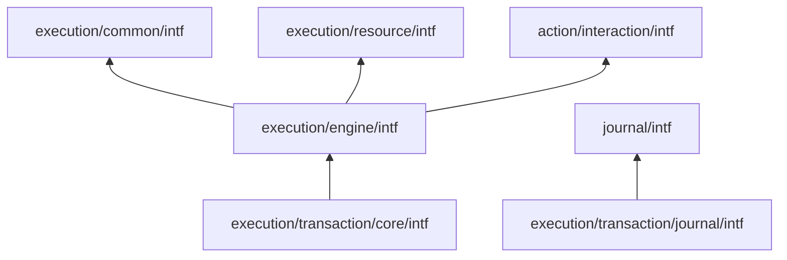
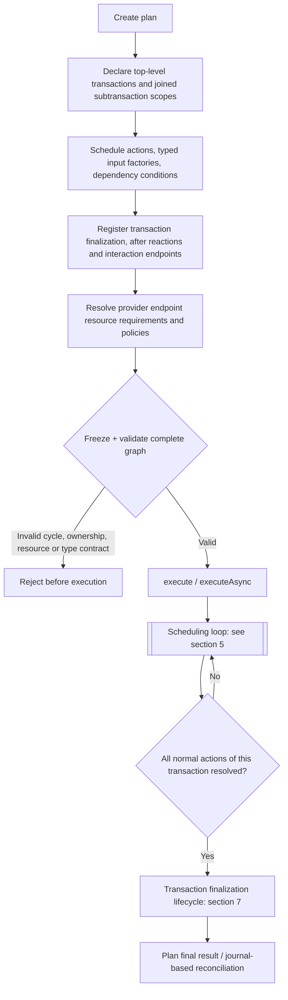
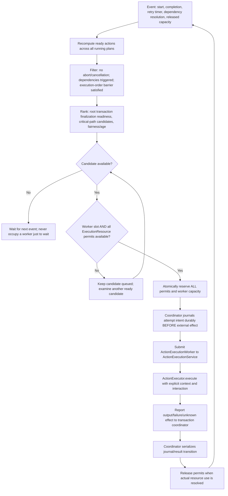
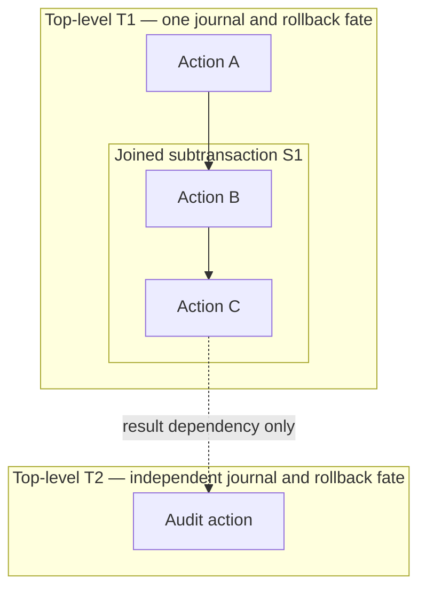
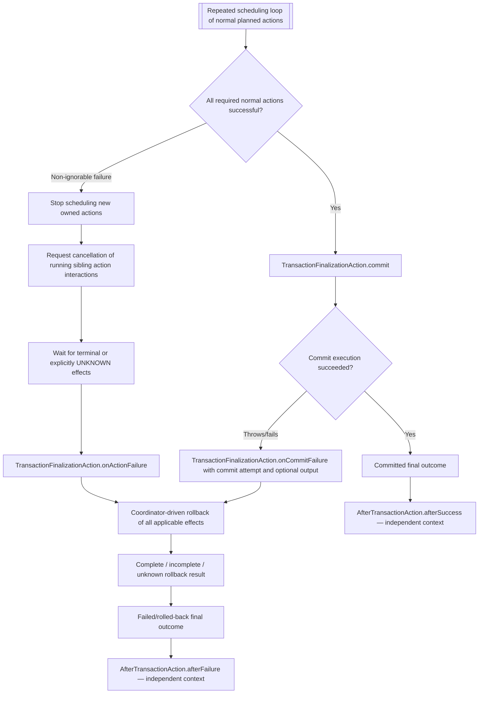
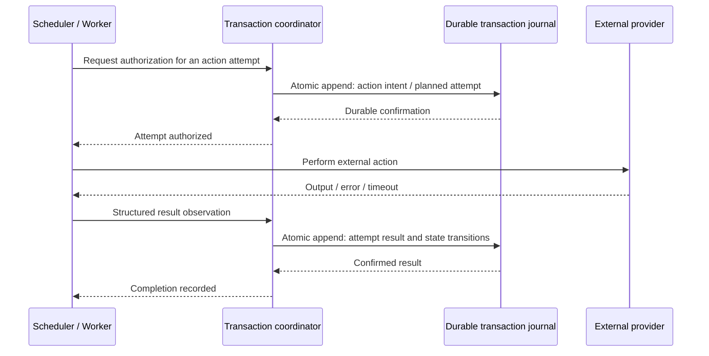

# Algites Action Framework — Reference Architecture (2026)

**Status:** first Java contract draft; interfaces only, no engine implementation.  
**Language baseline:** Algites 2026: Java 25 LTS, Python 3.13 (Python port not yet implemented).  
**Scope:** `pub.lib.General/action`, plus the independent `pub.lib.General/journal` dependency.

This is the single normative conceptual document for the Action family. Each section has a stable heading for cross-links; Java interfaces provide complementary method-level Javadoc. The purpose of this first draft is to make type relationships, execution ownership, transaction boundaries and unimplemented guarantees inspectable **before** deciding concrete algorithms and providers. Names and conventions below are proposed contracts, not claims that the scheduler or persistence is already working.

## 1. Architectural goals and non-goals

- **Static definition, reactive execution:** register the complete action/transaction graph, result-dependent factories, callbacks, resource bindings and interaction capabilities **before** `execute`. The graph is frozen and validated before any domain effect.
- **No mutation of running plans:** an executing action or hook cannot add actions, dependencies, listeners or subtransactions to its source plan. It may construct and execute a **new independent plan**; the new plan has its own immutable graph and transaction fate.
- **Multiple actions per transaction:** a top-level transaction may own many concurrently running actions. Transaction ownership is a logical relation, not a particular worker thread or physical DB transaction.
- **Coordinator-controlled effects:** transaction state transitions, journal records, commit and rollback are serialized per top-level transaction while actual actions may run concurrently.
- **Typed extension:** `ActionInput`, `ActionOutput`, intermediate state results, failure contexts, commit results and transaction reactions are interfaces, including typed generics for language/application-specific subtypes.
- **Public API never silently promises ACID across Cloudsmith, S3, Maven, filesystem or other unrelated services.** We coordinate long-running external operations with durable intent recording, reconciliation and best-effort rollback.
- **No general rule engine/backtracking:** prerequisites trigger preconfigured actions. This is not a general unification or recursive Prolog engine.
- **No global active-transaction limit for now:** a waiting transaction need not consume a worker. Limit runnable operations using worker capacity and endpoint `ExecutionResource` allocations.

## 2. Artifact and Java package boundaries

```text
pub.lib.General/
├── journal/
│   ├── intf/
│   └── impl/                  (existing in-memory implementation)
└── action/
    ├── ACTION-FRAMEWORK.md
    ├── interaction/
    │   └── intf/
    └── execution/
        ├── common/intf/
        ├── resource/intf/
        ├── engine/intf/
        └── transaction/
            ├── core/intf/
            └── journal/intf/
```

`intf ↔ impl` and `coreintf ↔ coreimpl` are the naming pairs; never introduce `coreimpl` as the counterpart of a plain `intf`. Empty implementation modules are **not** created as if they were already working. `common/intf` contains only concepts needed by both engine and transaction without cyclic dependencies. Interfaces share plain Java semantics and must remain usable outside Gradle/Modustro at runtime.



## 3. Glossary: action, executor, worker, scheduler, service, plan

| Name | Responsibility | Not responsible for |
|---|---|---|
| `ActionInput` | Immutable or execution-stable typed input | Execution status |
| `ActionOutput` | Typed business output from the domain action | History of attempts; rollback result |
| `ActionExecutor<IN,OUT,CTX>` | Domain code that runs one attempt | Thread ownership, cross-action orchestration |
| `ActionExecutionWorker<R>` | One technical runnable/short-lived work unit | Owning a permanently dedicated thread |
| `ActionExecutionService` | Admits and dispatches technical worker units to JVM execution facilities | Domain operations and transaction journal |
| `ActionExecutionEngine` | Coordinates all plans, the scheduler, readiness and resource allocations | Provider-specific domain effects |
| Scheduler (engine subsystem) | Picks next runnable work under dependencies, order barriers and resource budgets | Deciding transaction ownership |
| `ActionExecutionPlan` | Defined/frozen graph of known work and prerequisites | A queue, a journal, or a worker thread |
| `ExecutionTransaction` | Top-level owner of external effects, commit and rollback | Owning a thread pool |
| Transaction coordinator (transaction implementation subsystem) | Serializes decisions, journaling, finalization and rollback | Doing arbitrary provider I/O in its critical section |
| `ExecutionResource` | Stable shared capacity identity, typically derived from an endpoint | Per-action configurable capacity |

### 3.1. Why `Result` differs from `Output`

An `ActionOutput` is meaningful domain data (e.g. published artifact identity). `ActionExecutionResult<OUT,AO>` reports final attempt status, optional output, failures and all attempt records. Failure can occur without any `Output`; remote effects can exist even after a failed/timeout attempt. `TransactionExecutionResult` additionally captures commit output (if any), rollback and each action's final external-effect state. The same separation is normative for Python.

## 4. Static plan preparation, freeze, execution and publication of results



`freeze()` checks structural invariants and makes all scheduling declarations immutable. Once execution starts, only *runtime states and journals* change. Conditional actions are known in advance; input factories are evaluated later from immutable predecessor results and **must have no external side effects**. A dependent action whose condition can no longer become true resolves as NOT_TRIGGERED/SKIPPED, rather than waiting forever.

`ExecutionOrder` is a **local ordering/barrier rule among siblings**, not a global priority value. Later order groups cannot start if a required earlier barrier has not resolved, even if endpoint capacity is available. Independent scopes may progress concurrently. The exact barrier semantics for conditional skips and ignored failures must be pinned down in implementation tests.

## 5. Scheduling loop: readiness, priority, resource admission and dispatch

**The scheduler operates at the engine level** across multiple concurrent plans and top-level transactions. It owns no domain payload; worker threads come from `ActionExecutionService`. `TransactionCoordinator`/scope state is not itself a worker pool. The initial scheduler is proposed as *work-conserving and fair*, rather than promising provably optimal scheduling (multi-resource precedence scheduling is generally computationally difficult).



This diagram is a **design**, not a statement of an implemented scheduling policy. In the final implementation the `CAND` cycle must track exhausted candidates per scheduling turn; it must not busy-loop repeatedly examining the same blocked action. A timeout does *not* guarantee that an external operation is no longer running. Resource release after `UNKNOWN` requires an explicit safe policy and reconciliation. Similarly the coordination between durable intent and dispatch must not leave an unjournaled external effect.

### 5.1. Three independent limits

1. **Worker capacity**, shared among actions (`ActionExecutionService.getMaxConcurrentWorkers()`).
2. **Endpoint/resource capacities**, configured by the provider endpoint, exposed as named `ExecutionResource` identities and coordinated globally across **all plans in the same engine**. The endpoint owns `MaxConcurrentPublications` or `MaxConcurrentSubscriptions`, not `ActionExecutionPolicy`. The scheduler binds an action to provider-derived requirements before freeze.
3. **Ordering/dependencies**, logical constraints on the graph; no resource acquisition can override them.

No `MaxConcurrentTransactions` initially. Transactions waiting on dependencies may be numerous without holding workers. Resource slots must be acquired **all-or-nothing**, to avoid deadlocks from partial acquisition. This model supports a capacity of 1 for exclusive object identity access and a larger capacity for provider throughput. Rate limiting is a separate possible future capability.

Per-engine resource coordination does not imply a distributed limit across multiple Builder JVMs. It requires a shared coordinator implementation if multi-process capacity guarantees become necessary. In Gradle, native Maven dependency resolution is not automatically gated by our scheduler: a subscription adapter must explicitly implement its declared limit or report inability to enforce it.

### 5.2. Prioritizing finalization without starvation

Among eligible candidates with their ordering and resource prerequisites satisfied, consider selecting work that unlocks a transaction's `commit`/rollback and releases owned state sooner. This is a **scheduler preference, not a guarantee** and may never violate explicit `ExecutionOrder`, dependency gates or endpoint concurrency. Fairness/age prevents long-lived ready work from starving. The scoring/selection algorithm, tie breaking and resource fairness are intentionally not finalized in this interface-only version.

## 6. Hierarchical transaction ownership and cross-transaction dependencies



- A joined subtransaction is a hierarchical execution scope inside a top-level transaction. It cannot irrevocably commit while its root may still roll back.
- An independent transaction is **always a top-level transaction**, never a `JOINED/INDEPENDENT` subtransaction mode.
- Dependencies, causal links and correlation identifiers do **not** transfer transaction membership.
- A transaction may have multiple `dependsOn(target, condition)` registrations before freeze; `isDecidable()` must be true before a false predicate is considered definitively non-triggering.
- Pending scopes and nodes have known ownership while actions can be physically executed by different workers. The same worker can execute unrelated transactions successively.
- A fresh plan created inside an action has separate root transaction ownership. Waiting synchronously for it creates a scheduling wait edge; cycles across such waits must be rejected or safely detected.

## 7. Transaction execution, commit, rollback and final-result reactions

`TransactionFinalizationAction<CI,CO,FC,AF,CF>` owns the phase-specific `commit`, `onActionFailure` and `onCommitFailure`. Its `commit` receives the specialized `FC` context and performs the actual finalizing operation **only after normal work succeeds**. `commit` must not hide failed effects through ad-hoc internal repair: when it fails, the coordinator captures its full attempt result and dispatches to `onCommitFailure`.

`AfterTransactionAction<TSR,TFR,CTX>` is a different concept: its `afterSuccess` and `afterFailure` methods observe **definitive** transaction outcomes after commit or rollback. Their result types **and** action contexts are generic and may be specialized by Builder/AAC. Any such action operates independently of the source transaction's rollback fate; its failure must not rewrite a committed or rolled-back source transaction.



`onActionFailure` is invoked when a normal scheduled action causes non-ignorable abort *before any commitAction*, while `onCommitFailure` is invoked upon failed commitAction and can access the commit attempt, its partial `Output` if produced, and its uncertainty. Both failure paths are followed by coordinator-controlled rollback according to their documented phase policy. Errors raised by failure handlers are **additional errors** and cannot erase the original error.

`AfterTransactionAction.afterFailure` receives an immutable `TransactionFailureResult` containing the **complete list/tree** of known action executions, results, attempts, skipped actions, attempted rollback results and unknown effects. It is not merely given the first thrown exception. `afterSuccess` receives a typed `TransactionSuccessResult`, including the `commit` action output.

A rollback executor is a predeclared **action** executed through the same technical worker service and resource limitations. Transaction coordination decides which effects need rollback, typically in reverse dependency order; for independent parallel effects journal completion order is not necessarily a safe rollback order. Rollback cannot recursively cause unlimited rollback of itself.

### 7.1. Cancellation cascade and unresolved remote effects

For `ABORT_TRANSACTION`, the transaction coordinator: stops dispatch of unscheduled work in that root, sends cooperative cancellation requests to all currently running owned action interactions, waits for bounded quiescence when possible, records unknown outcomes where effects cannot be proven, and executes the predeclared rollback actions. Concurrent sibling cancellation must **not** be treated as evidence that remote provider writes ceased. A newly independent top-level transaction is not rolled back because it was causally launched from the failing source.

### 7.2. Best-effort transaction semantics

Cross-provider atomic commit is not promised. All effectful attempts require intent-before-effect records, stable executor identities and enough serializable inputs to reconcile outcomes after restart. A `ROLLBACK_COMPLETE` result may only be claimed after verifying that all relevant effects were resolved; failed/unknown effects must remain visible in journal and final result. Pure actions need no rollback effects; irreversible actions must report their limitation honestly.

## 8. Transaction journal and external-effect recovery

The independent `journal/intf` contract already defines immutable snapshots, atomic append batches, before-append veto and after-append notification. `transaction/journal/intf` specializes its entry content and lifecycle. A root transaction logically owns one journal stream; child joined subtransactions share that root's rollback fate and journal, with separate scope identifiers.



**Unresolved durability question:** an in-memory journal is useful for tests but is not crash-durable. Before claiming reliable recovery, we must provide a persistent journal backend with documented commit semantics and outbox/replay for cross-transaction reactions. Generic `JournalListener` callbacks alone are not guaranteed delivery after JVM crash. A timeout during journal append may itself leave uncertain persisted state depending on backend; this must not be conflated with a veto from `beforeAppend`.

## 9. Typed interaction and progress reporting

Provider-facing `AIiActionInteractionProviderToCaller<E,F,S,PM,CM>` and caller-facing `AIiActionInteractionCallerToProvider<E,F,S,PM,CM>` **do not inherit from each other**. A controller may implement both, but each participant receives only the authorized direction.

AAC-inspired common semantics: structured status/progress/detail/diagnostic events; hierarchical progress identifiers; capabilities versus caller preferences; cooperative cancellation; foreground/background presentation independent of synchronous/asynchronous execution; interim state-result revisions independent of interaction revisions and final `ActionOutput`; negotiated ON_DEMAND_COMPLETE, ON_DEMAND_DELTA, ON_CHANGE_COMPLETE, ON_CHANGE_DELTA and ALWAYS_COMPLETE delivery.

The present Java interfaces capture foundational semantics and generics **only**. A future AAC migration must verify each event type, revision and transport protocol contract without introducing an accidental inheritance direction. The provider can query caller preferences; only the engine/coordinator owns authoritative execution and transaction lifecycle changes. High-frequency progress belongs in the interaction stream, not in the durable transaction effect journal.

## 10. Concurrency model and language portability

Java 25 LTS is the Algites 2026 Java target; Python 3.13 is the corresponding minimum development baseline. `ScopedValue` is permitted as Java 25 implementation convenience; Python may use `contextvars.ContextVar`. Neither is an authoritative owner of transaction membership. A worker or asynchronous operation receives an explicit execution context determined at planning time; context propagation must be controlled for all task submission implementations.

`StructuredTaskScope` is not a mandatory API dependency of the first baseline. Initial implementations may use stable executor APIs / virtual threads, but **workers must not block simply to acquire an endpoint permit**. In Python, typed generic `Protocol`/`ABC` contracts should mirror intent, bounds and result semantics, with static type checking as part of CI. No extra cross-language DSL or generated universal schema is required. The common behavioral reference is this document plus mirrored conformance tests.

## 11. Contract lifecycle and invariants

| Contract | Core invariant / validation obligation |
|---|---|
| Plan | No graph mutation after freeze; reject invalid cycles, missing owners and illegal dependencies |
| Action input factories | Pure and statically registered; output typed; no unjournaled effects |
| Executor | May run only after coordinator's durable intent approval for effectful work |
| Scheduler | Respect order, dependencies, worker capacity and all endpoint capacities simultaneously |
| Resource coordinator | Engine-global per resource id; atomic all-or-nothing reservations; thread-safe |
| Transaction | Exactly one root owns any given action effect; child scope shares root rollback |
| Cross-transaction dependency | Orders work but never transfers ownership |
| Transaction journal | Ordered atomic writes; state transitions serialized; retain unknown outcomes |
| Failure response | Abort cancels siblings, records their actual/unknown effects, then compensating rollback |
| Commit | Only after successful normal work; failure is handled by onCommitFailure |
| After actions | Receive final typed immutable results; no retroactive modification of the original plan |
| Interaction | Provider/caller directions do not inherit; cancellation is cooperative |
| Snapshot | Structural and entry-level immutability required; no shared mutable payloads |

### 11.1. Known open design decisions

1. Detailed scheduler scoring, fair selection under resource contention, transaction-finalization preference and starvation limits.
2. Ordering/barrier behavior with ignored failures and skipped conditional dependencies.
3. Exact contract for recovering an executor and a typed input factory across JVM restarts.
4. Provider-specific idempotency/unknown effect reconciliation and release of permits after timeouts.
5. Precise phase policy and retry/failure handling for rollback actions and for the failure handlers themselves.
6. Contract between externally configured endpoint limits and capacity shared across endpoints, engines and processes.
7. Exact AAC feature parity, progress and intermediate state-result protocol details.
8. Typed specialization of nested transaction result trees in both Java and Python.

These are *explicit open contracts*, not intentionally hidden implementation freedoms. A first implementation must resolve each it actually exercises before promising those guarantees.

## 12. Mandatory behavioral conformance tests (later implementation phase)

All tests must run under the standard Gradle/TestNG `test` task; no manual-only smoke tests.

| Scenario | Expected behavior |
|---|---|
| Three parallel actions sharing one root transaction | Concurrent provider execution, one serialized transaction history |
| Endpoint resource limit across two plans | Combined concurrent usage never exceeds configured limit |
| Blocked endpoint and independent ready action | Scheduler dispatches other action without blocking a worker |
| ExecutionOrder barrier | Later sibling order group cannot run prematurely |
| Finalization-priority scheduling | Priority never violates dependencies/limits; no starvation |
| Abort on failure during parallel work | Sibling cancellation requested; all effects resolved or UNKNOWN; rollback attempted |
| Ignored action failure | Reported but does not trigger root rollback by itself |
| Commit action throws after partial effect | onCommitFailure receives complete attempt/error snapshot; rollback triggered |
| Failure handler itself throws | Original failure preserved; handler failure also reported |
| Rollback action fails | Result explicitly INCOMPLETE or UNKNOWN; never falsely COMPLETE |
| Separate audit transaction commits, parent rolls back | Audit persists; afterFailure records final source state |
| Attempt to modify running plan | Explicit rejection before changing any declarations |
| Scope or cross-plan dependency cycle | Rejected at freeze if statically resolvable; runtime wait cycles guarded |
| Concurrent interaction progress and cancellation | Snapshot revisions consistent; callback never escalates provider authority |
| JVM crash between intent and external effect | Recovery identifies intended but uncertain operation |
| Cross-JVM endpoint limit | Must be supported by distributed coordinator or explicitly documented unavailable |

## 13. Repository migration and schema ownership

Builder descriptor YAML schemas formerly in `pub.gov.Algites/devops/build/yamldefs` are being copied into `pub.pltf.Modustro/platform/builder/coreintf`, with their existing `GlobalPublicationPathId` public namespaces and new source `$id` references. The legacy governance copy is retained during the transition. Ensure only the authoritative repository publishes each public schema identity when switching to the new Builder.
