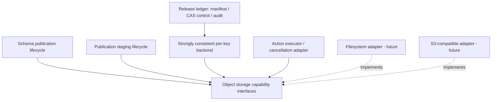

# Algites Object Storage — Interface Architecture (2026)

## 1. Scope

`storage/object/intf` is a **backend-neutral binary object storage SPI** in
`pub.lib.General`, with Java package `eu.algites.lib.storage.object`. This phase
introduces interfaces and one checked exception, **not an implementation**.
The first intended consumers are Modustro publication staging, immutable
schema/deploy-sidecar publication and durable release-ledger state; the SPI is
also usable outside Modustro. A filesystem adapter and an S3-compatible adapter
are later implementation steps and must pass the same conformance suite.

The storage SPI is **not** the Modustro release ledger domain API; it does not
know `VersionScope`, `ReleaseId`, `Action`, `Transaction`, journal semantics,
`SchemaReferenceBaseUri`, credential profiles, publication status or provider
configuration. Those remain in higher-level components. This prevents the
storage transport from becoming a second Action Execution engine.

## 2. Module and ownership

```text
storage/
  modustro-artifact-set.yml
  object/
    modustro-artifact-set.yml
    OBJECT-STORAGE.md
    intf/
      modustro-artifact.yml
      src/product/java/eu/algites/lib/storage/object/*.java
      src/develop/java/eu/algites/lib/storage/object/*Test.java
```

All contracts belong to the shared `1.1-SNAPSHOT` Version Scope of
`pub.lib.General`. There are no intra-repository version-pinned dependencies.
Java 17-compatible interfaces are used to preserve the existing bootstrap;
future Java/Python adapters must respect the same behavioral semantics.

## 3. Layering



Actions may adapt their cancellation signal/deadline into
`AIiObjectStorageOperationContext`; storage itself never schedules actions or
selects failure policies. Execution concurrency limits remain in the global
Action Execution Resource Coordinator, not in the storage API.

## 4. Storage identity and keys

A storage instance represents **one configured namespace**, including its
bucket/root prefix and authorization scope. `getStorageId()` is stable, not
secret, and must distinguish independent namespaces or credentials-bound
security roots. It is not a URL, a bucket name necessarily, nor an action ID.

All object keys are **relative to that namespace**. Canonical keys are UTF-8
logical names with `/` separators; neither callers nor implementations may
accept absolute paths, backslash separators, NUL/control characters, empty
segments or `.`/`..` segments. An empty key is invalid. A list prefix may be
empty. URI escaping and backend-specific bucket/path handling are solely the
adapter's responsibility. Keys must not escape the configured namespace root.

A byte sequence is the object value. Provider metadata is auxiliary and does
not define schema or publication semantics. For protected payloads, the caller
computes and verifies SHA-256 over **actual bytes**. An ETag is never assumed
to be a SHA-256/MD5 content hash.

## 5. Capability segregation

| Interface | Operations | Typical user |
|---|---|---|
| `AIiObjectStorage` | namespace identity | all clients |
| `AIiObjectStorageReader` | HEAD, version-consistent streaming GET | preflight, verification, recovery |
| `AIiObjectStorageCreateOnlyWriter` | atomic create-if-absent | immutable manifest/payload/events |
| `AIiObjectStorageConditionalUpdater` | exact-revision atomic CAS | mutable ledger control and lease |
| `AIiObjectStorageOverwriter` | unconditional write | mutable snapshot outputs only |
| `AIiObjectStorageLister` | paged prefix list | administrative discovery |
| `AIiObjectStorageConditionalDeleter` | exact-revision delete | permitted staging retention cleanup |
| `AIiObjectStorageStronglyConsistentBackend` | reader + create-only + CAS, linearizable | durable ledger primitive |

These independent facets matter: a staging uploader may only need create-only
write permissions; a ledger requires reads, atomic creates and CAS. A schema
publisher may need read/create/CAS but must apply its own draft/release policy.
No generic interface permits an API call to magically escalate permissions.

`AIiObjectStorageStronglyConsistentBackend` is an explicit promise of *real*
per-key consistency across multiple processes/agents. A filesystem adapter
must establish this even on its actual shared filesystem. An S3-compatible
provider must be tested for real conditional semantics: simple check-before-PUT,
process-local mutexes, ETag comparisons implemented only on the client, and
``local-copy`` are insufficient. When not supported, fail configuration/preflight
rather than silently degrade to unsafe behavior.

This is *not* a distributed transaction and does not make publication across
distinct keys atomic. Ledger control fencing and action-level recovery remain
separate higher-level concerns.

## 6. Operation semantics

- `head(key)` and `openRead(key)` return `Optional.empty()` **only on proven
  absence**. Access denied, remote outage, stale/ambiguous response or other
  errors must fail distinctly. Listing is never proof of absence.
- `openRead()` couples content and metadata to one revision; the caller owns
  the returned handle and MUST close it. Reads must be streaming.
- `AIiObjectStorageContentSource` is replayable and declares a precise length;
  providers close streams they open. An interrupted retry cannot change bytes.
- `createIfAbsent` is atomic at the provider, not implemented as HEAD+PUT.
- `replaceIfRevisionMatches` uses the *opaque, backend-issued revision token*;
  it never uses local clocks or the presumed current SHA-256 as the condition.
  A token must not become valid again after delete/recreate (ABA).
- A definitive rejected condition throws
  `AIxObjectStoragePreconditionFailedException` and proves this particular
  operation did not mutate the object. An ordinary `IOException`, timeout,
  cancellation or connection loss must be handled as **possibly committed**.
  Reconcile by observing remote object state/bytes before retrying.
- A successful receipt identifies the committed object revision. Backend
  durability and consistency have to be stated by each implementation.
- `AIiObjectStorageOverwriter` is deliberately *not* inherited by the ledger
  backend; release payloads/manifest must never silently overwrite.
- Deletion is optional and conditional. Release ledger manifest/events are not
  cleanup targets. Staging deletion additionally requires a higher-level
  retention decision and verified release completion.

Cancellation and deadlines are advisory/cooperative, not remotely atomic undo.
Operations may observe deadlines before, during and after streaming; a timeout
while writing may leave an object committed. An Action coordinator must never
infer rollback success solely from cancellation of a storage operation.

## 7. Modustro use cases

**Schema site:** A domain-specific layer validates global path metadata,
content checksums, draft/release transitions and sidecar consistency; it uses
storage reader/writer capabilities as transport. The two-object schema plus
metadata pair is **not atomic** and must be recovered/validated explicitly.

**Publication staging:** Payload names are content-addressed (and scoped by
invocation and stability policy as needed). Create-only and read-back verification
allow an agent to resume with identical original bytes. Staging is a distinct
contract from the release ledger. Retention is a domain-level decision.

**Release ledger:** The control record is updated by CAS with a fencing
generation. Manifest and audit events are created immutably. Multiple keys
cannot commit atomically; higher-level state machine reconciles incomplete
attempts. Lease expiry does not prove termination of remote writes. A final
publication adapter must independently support create-only/verification.

## 8. Mandatory conformance tests for actual adapters

1. Two independent clients race to create the same key; exactly one succeeds.
2. Two independent clients CAS the same observed revision; exactly one succeeds.
3. Stale revision after update/delete+recreate cannot succeed (ABA guard).
4. Confirmed 404 returns empty; 403/timeout/unavailable is **not** empty.
5. HEAD/GET metadata and streamed bytes refer to the same observed revision.
6. Concurrent overwrite during read must not splice bytes of two versions.
7. A timeout after request delivery requires reconciliation, never blind retry.
8. Multipart/large stream transfers do not buffer entire payload in memory.
9. Prefix key traversal, wrong-prefix names and unsafe encodings are rejected.
10. Cancelled write does not imply absent object; verify before further actions.
11. With two processes/hosts, conditional claims remain atomic; no JVM-local
    locks masquerade as distributed consistency.
12. Provider listings may be stale; listing never influences CAS correctness.
13. Permissions: independent read, write and delete grants enforce least privilege.
14. Staging retention never deletes FAILED/INCOMPLETE release payloads.
15. Cleanup is idempotent only after exact-revision checks and domain approval.

## 9. Explicitly deferred

- Concrete filesystem and S3/Scaleway implementations and credentials handling.
- Multipart upload/session lifecycle and retry/recovery of individual parts.
- Provider-specific checksums, SSE/encryption and object lock/retention policies.
- Python contract/adapter (currently Java SPI only).
- Integration into Modustro Builder schema-publisher/release-ledger services.
- Action-specific typed Input/Output implementations and resource endpoint policy.
- A cross-provider migration/replication abstraction; list is not a snapshot.
